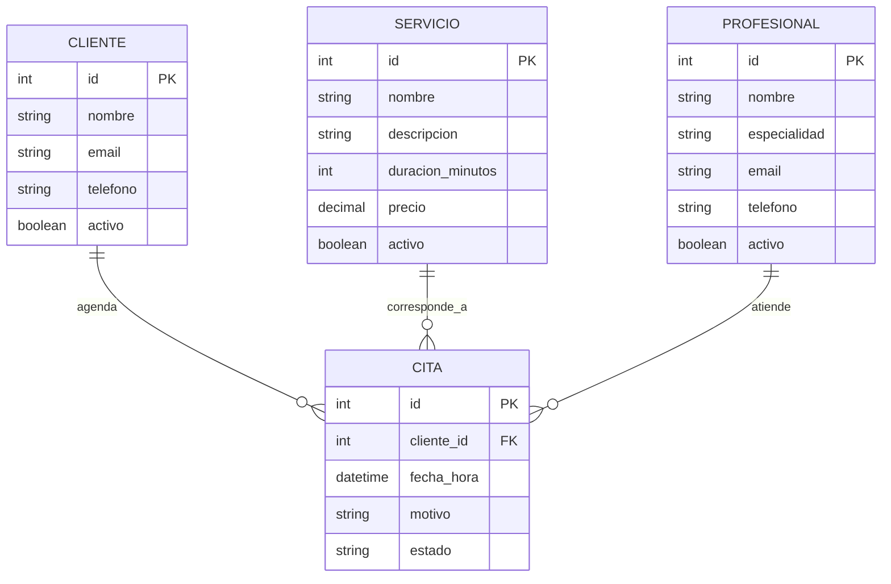

# Diagrama de entidades — agenda de servicios

Este diagrama separa el **modelo conceptual de cuatro entidades** del **modelo relacional implementado en el código** (incluyendo reservas multiservicio y seguridad JWT).

## Modelo conceptual

Una cita vincula a un cliente con uno o más servicios atendidos por profesionales.



## Modelo relacional implementado en el código

El esquema actual normaliza la asignación de servicios por profesional (profesional_servicios), permite reservas con múltiples servicios (reservas + detalle_reservas) asociadas 1:1 a una cita, y gestiona usuarios, refresh tokens y recuperación de contraseña.

```mermaid
erDiagram
    CLIENTES ||--o{ RESERVAS : realiza
    RESERVAS ||--|{ DETALLE_RESERVAS : contiene
    RESERVAS ||--o| CITAS : origina
    PROFESIONALES ||--o{ PROFESIONAL_SERVICIOS : ofrece
    SERVICIOS ||--o{ PROFESIONAL_SERVICIOS : se_asigna
    PROFESIONAL_SERVICIOS ||--o{ DETALLE_RESERVAS : programa
    USUARIOS ||--o{ REFRESH_TOKENS : emite
    USUARIOS ||--o{ TOKENS_RECUPERACION_USADOS : consume

    CLIENTES {
        int id PK
        string nombre
        string email UK
        string telefono
        boolean activo
    }
    SERVICIOS {
        int id PK
        string nombre
        text descripcion
        int duracion_minutos
        decimal precio
        boolean activo
    }
    PROFESIONALES {
        int id PK
        string nombre
        string especialidad
        string email UK
        string telefono
        boolean activo
    }
    PROFESIONAL_SERVICIOS {
        int id PK
        int profesional_id FK
        int servicio_id FK
    }
    RESERVAS {
        int id PK
        int cliente_id FK
        datetime fecha_creacion
    }
    DETALLE_RESERVAS {
        int id PK
        int reserva_id FK
        int profesional_servicio_id FK
        datetime fecha_hora_inicio
        int duracion_minutos
        decimal precio
    }
    CITAS {
        int id PK
        int reserva_id FK_UK
        datetime fecha_hora
        string motivo
        string estado
    }
    USUARIOS {
        int id PK
        string nombre
        string email UK
        string password_hash
        string rol
        boolean activo
        int token_version
        int intentos_fallidos
        datetime bloqueado_hasta
    }
    REFRESH_TOKENS {
        int id PK
        int usuario_id FK
        string token_hash UK
        string familia_id
        boolean revocado
        datetime expira_en
        datetime creado_en
    }
    TOKENS_RECUPERACION_USADOS {
        int id PK
        string jti UK
        int usuario_id FK
        datetime consumido_en
    }
```

### Reglas estructurales implementadas

- profesional_servicios posee restricción única sobre (profesional_id, servicio_id).
- detalle_reservas posee restricción única sobre (reserva_id, profesional_servicio_id) y restricciones CHECK (duracion_minutos > 0, precio >= 0).
- citas.reserva_id es único (FK_UK), garantizando una relación 1:1 entre reserva y cita con borrado en cascada (ON DELETE CASCADE).
- Los usuarios disponen de rotación de refresh_tokens por familia_id, invalidación global por token_version y registro de jti de un solo uso en tokens_recuperacion_usados.
