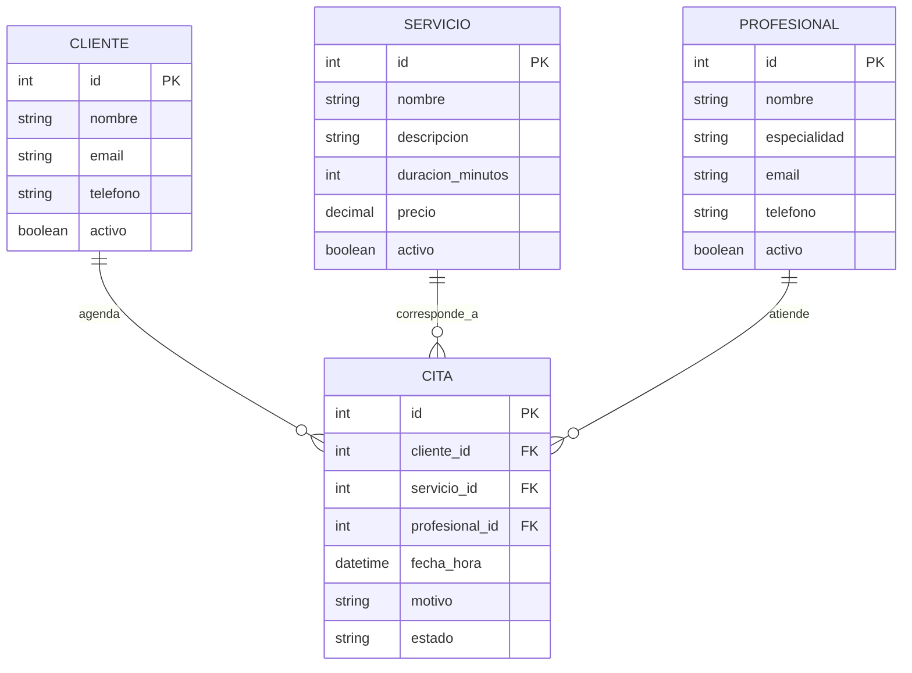

# Diagrama de entidades — agenda de servicios

Este diagrama separa el **modelo conceptual de cuatro entidades** solicitado para la muestra del **modelo relacional que hoy aparece en el código**. Los campos propuestos para el modelo conceptual deben acordarse con el equipo antes de tratarlos como contrato definitivo.

## Modelo conceptual propuesto

Una cita referencia un cliente, un servicio y un profesional. Por eso cada relación es 1:N desde la entidad de catálogo hacia las citas.



## Modelo relacional que implementa el código actual

El código normaliza la asignación de servicios a profesionales y separa una reserva de los datos de la cita. Por ello, `citas` no tiene claves foráneas directas a `clientes`, `servicios` y `profesionales`: la ruta de citas aplana esas relaciones en su respuesta HTTP.

```mermaid
erDiagram
    CLIENTES ||--o{ RESERVAS : posee
    PROFESIONALES ||--o{ PROFESIONAL_SERVICIOS : ofrece
    SERVICIOS ||--o{ PROFESIONAL_SERVICIOS : se_asigna
    PROFESIONAL_SERVICIOS ||--o{ RESERVAS : habilita
    RESERVAS ||--o| CITAS : detalle

    CLIENTES {
        int id PK
        string nombre
        string email UK
        string telefono
        boolean activo
    }
    SERVICIOS {
        int id PK
        string nombre
        string descripcion
        int duracion_minutos
        decimal precio
        boolean activo
    }
    PROFESIONALES {
        int id PK
        string nombre
        string especialidad
        string email UK
        string telefono
        boolean activo
    }
    PROFESIONAL_SERVICIOS {
        int id PK
        int profesional_id FK
        int servicio_id FK
    }
    RESERVAS {
        int id PK
        int cliente_id FK
        int profesional_servicio_id FK
        datetime fecha_creacion
    }
    CITAS {
        int id PK
        int reserva_id FK_UK
        datetime fecha_hora
        string motivo
        string estado
    }
```

La tabla `profesional_servicios` representa la relación N:M entre profesionales y servicios; su pareja de claves foráneas es única. `citas.reserva_id` es único, de modo que una reserva puede tener cero o una cita asociada en el esquema actual.

## Validaciones pendientes con el grupo

- Confirmar que el negocio efectivamente agenda citas y que los tres tipos de actor propuestos participan.
- Acordar atributos y cardinalidades definitivos, especialmente la relación reserva/cita.
- Confirmar si se permitirán varias reservas para el mismo profesional en horarios que se traslapen.

Los puntos del problema son hipótesis hasta que se conversen con el negocio. Ver también [`avance-isidora.md`](avance-isidora.md).
