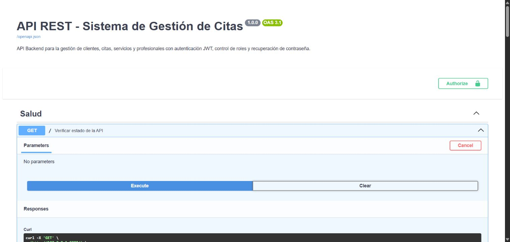
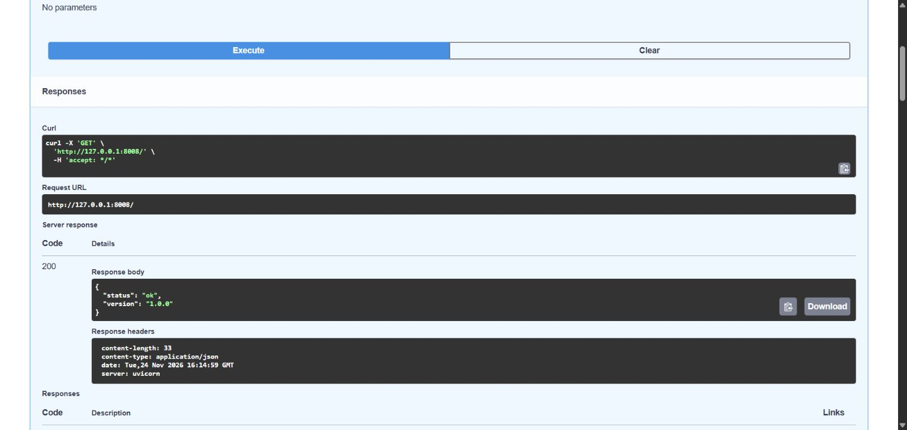
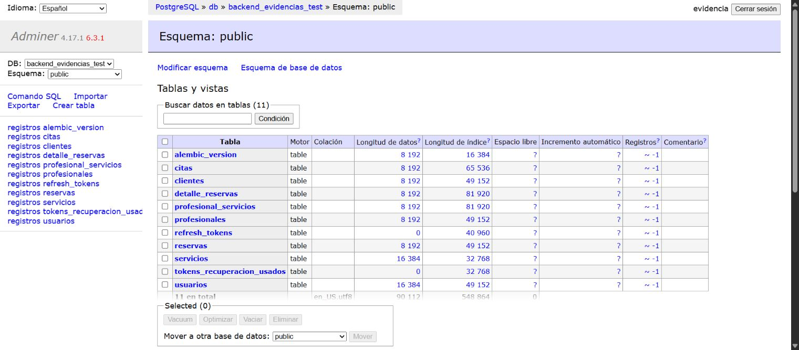

# Evidencias del 24 de noviembre de 2026

La revisión validada es `a931df826436d40a1976b2e306f361fc74f2a0aa`, sobre la base `main` `14b9af706c7fd760816a77fb5c075a70b7ef4ee3`. El [informe de validación](../../informe-validacion.md) explica los cambios y el alcance de las tareas 3 y 4. La [matriz de rúbrica](../../matriz-evidencias-rubrica.md) identifica las verificaciones completas, parciales y pendientes.

## Pruebas y cobertura

La batería completa terminó con **96 pruebas aprobadas**, cero fallos, cero errores, cero omisiones y cero advertencias con `-W error`. La cobertura de líneas de `app` fue **87,38%**, con 1.440 líneas cubiertas de 1.648 ejecutables y el umbral de 85% aprobado. Se incluyó el proceso Uvicorn de las pruebas E2E.

| Nivel | Aprobadas |
| --- | ---: |
| Unitarias | 21 |
| Regresiones con SQLite | 61 |
| Integración PostgreSQL | 11 |
| E2E por HTTP | 3 |
| **Total** | **96** |

| Archivo | Qué permite comprobar |
| --- | --- |
| [pytest.txt](pytest.txt) | Salida de la ejecución completa, cobertura por archivo y resultado final. |
| [junit.xml](junit.xml) | Casos, nivel, tiempos y ausencia de fallos, errores u omisiones. |
| [coverage.xml](coverage.xml) | Líneas ejecutables, cubiertas y tasa de cobertura de cada archivo. |
| [resumen.json](resumen.json) | Commit, entorno, conteos por nivel, opciones y huellas SHA-256 de los tres reportes. |

Este conjunto se ejecutó en Windows con Python 3.13.15 y PostgreSQL 18.6 nativo local. Las pruebas de PostgreSQL y E2E preparan esquemas aislados mediante Alembic y los eliminan al finalizar. La cifra de 88,26% indicada como antecedente requiere el reporte y el commit de aquella medición para reproducirla.

Para repetirlo, configurar `TEST_POSTGRES_URL` hacia una base PostgreSQL local exclusiva de pruebas siguiendo [pruebas.md](../../../pruebas.md) y ejecutar desde la raíz del repositorio.

```powershell
$env:E2E_STARTUP_TIMEOUT = '300'
if (-not $env:TEST_POSTGRES_URL) { throw 'Configura PostgreSQL local de pruebas según pruebas.md' }
.\.venv\Scripts\python.exe -m pytest -q -W error --cov=app --cov-report=term-missing --cov-report=xml:coverage.xml --cov-fail-under=85 --junitxml=pytest-result.xml
```

La ejecución conservada usó 300 segundos de plazo de arranque E2E tras observar demoras en el equipo. El valor predeterminado del código es de 60 segundos.

## Operación Docker local

El [registro de operación](docker-operacion.json) corresponde a una comprobación complementaria con Python 3.10.22, PostgreSQL 15.20 y Adminer. La imagen se construyó con un archivo limpio de `git archive` del commit `a931df8` y se etiquetó con esa revisión. El [Compose utilizado](compose.evidencias.yml) conserva la configuración reproducible de ese entorno. El archivo `.env` privado utilizado permanece fuera de las evidencias publicadas.

| Comprobación | Resultado conservado en `docker-operacion.json` |
| --- | --- |
| Servicios | `db`, `web` y `adminer` en ejecución. PostgreSQL con healthcheck saludable. |
| API y documentación | `GET /` respondió 200 antes y después de recrear `web`. `/openapi.json` respondió 200. |
| Visor de BD | Adminer respondió 200 en el puerto local 8088. |
| Migraciones | Once tablas en el esquema, incluida `alembic_version`, con revisión `c4d987ee6f20`. |
| Datos ficticios | Dos usuarios, dos clientes, dos servicios, dos profesionales, dos asociaciones y tres reservas, citas y detalles. |
| Persistencia | Se recreó únicamente `web`. Cambió su identificador de contenedor, se conservaron `db`, Adminer y el volumen, y permanecieron iguales las tablas, revisión Alembic, conteos e identificadores de datos. |
| Trazabilidad de imagen | Revisión completa, etiqueta, identificador SHA-256 y digest registrados. |

### Reproducir el entorno complementario

Usar una carpeta temporal y definir `EVIDENCE_DB_PASSWORD` y `EVIDENCE_JWT_SECRET` como variables privadas de la sesión PowerShell. La clave JWT debe ser aleatoria y de al menos 32 caracteres. Los puertos locales 55440, 8008 y 8088 deben estar disponibles. Desde la raíz del repositorio, estos comandos preparan `source/` con la revisión exacta y copian el Compose junto a esa carpeta.

```powershell
$evidenceRevision = 'a931df826436d40a1976b2e306f361fc74f2a0aa'
$evidenceProject = 'backend-evidencias-' + [guid]::NewGuid().ToString('N').Substring(0, 12)
$evidenceWork = Join-Path ([System.IO.Path]::GetTempPath()) ('backend-evidencias-' + [guid]::NewGuid().ToString('N'))
$evidenceSource = Join-Path $evidenceWork 'source'
$evidenceArchive = Join-Path $evidenceWork 'source.zip'
$evidenceCompose = Join-Path $evidenceWork 'compose.yml'
New-Item -ItemType Directory -Path $evidenceSource -Force | Out-Null
Copy-Item -LiteralPath 'docs/evidencias/2026-11-24/compose.evidencias.yml' -Destination $evidenceCompose
git archive --format=zip --output=$evidenceArchive $evidenceRevision
Expand-Archive -LiteralPath $evidenceArchive -DestinationPath $evidenceSource
$env:EVIDENCE_REVISION = $evidenceRevision

if (-not $env:EVIDENCE_DB_PASSWORD -or -not $env:EVIDENCE_JWT_SECRET) {
    throw 'Define las variables privadas EVIDENCE_DB_PASSWORD y EVIDENCE_JWT_SECRET'
}
docker compose -p $evidenceProject -f $evidenceCompose build web
docker compose -p $evidenceProject -f $evidenceCompose up -d db adminer
docker compose -p $evidenceProject -f $evidenceCompose run --rm web alembic upgrade head
docker compose -p $evidenceProject -f $evidenceCompose run --rm web python -m scripts.seed
docker compose -p $evidenceProject -f $evidenceCompose up -d web
docker compose -p $evidenceProject -f $evidenceCompose ps
Invoke-RestMethod 'http://127.0.0.1:8008/'
```

Swagger queda en `http://127.0.0.1:8008/docs` y Adminer en `http://127.0.0.1:8088`. En Adminer, el servidor es `db`, la base `backend_evidencias_test` y el usuario `evidencia`. La contraseña corresponde al valor privado configurado para el entorno.

Para repetir la comprobación de persistencia, registrar revisión Alembic, tablas, conteos e identificadores antes y después del siguiente comando y comprobar nuevamente `GET /`.

```powershell
docker compose -p $evidenceProject -f $evidenceCompose up -d --no-deps --force-recreate web
Invoke-RestMethod 'http://127.0.0.1:8008/'
```

Para consultar logs y detener los servicios conservando el volumen, usar los comandos siguientes.

```powershell
docker compose -p $evidenceProject -f $evidenceCompose logs web
docker compose -p $evidenceProject -f $evidenceCompose down
```

## Capturas conservadas

### Swagger

La cabecera muestra la API de gestión de citas y la operación de salud disponible.



### Salud HTTP

La ejecución desde Swagger muestra la solicitud a `http://127.0.0.1:8008/`, el estado 200 y el cuerpo `{"status":"ok","version":"1.0.0"}`.



### Tablas PostgreSQL

Adminer muestra las once tablas del esquema `public` de `backend_evidencias_test`. La revisión Alembic y los conteos exactos se conservan en el registro JSON de operación.



## Evidencia pendiente

Queda pendiente la captura de Docker Desktop: el control de la interfaz se interrumpió mediante Escape. Los estados de los contenedores, la revisión Alembic, los conteos y la comparación antes/después están registrados en [docker-operacion.json](docker-operacion.json).

El Compose complementario incorpora un visor y variables de JWT/correo para esta comprobación. El criterio C3 completo requiere integrar y verificar la configuración final del proyecto. También quedan pendientes CI verde, fallo bloqueado, revisión promovida a Kubero con HTTPS y sus evidencias de operación. La [matriz de rúbrica](../../matriz-evidencias-rubrica.md) conserva el alcance de cada pendiente.
