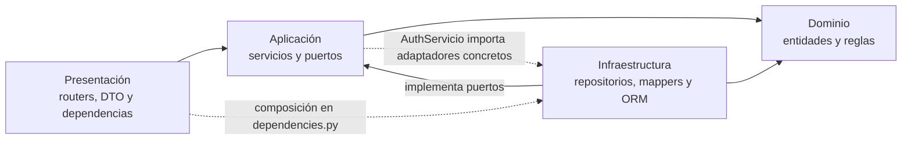

# Revisión de arquitectura de cuatro capas

**Responsable:** Isidora Valverde

**Fecha de revisión:** 24 de noviembre de 2026

**Base examinada:** `main`, commit `14b9af706c7fd760816a77fb5c075a70b7ef4ee3`
**Tarea 3:** diagnóstico y propuesta de correcciones acotadas.

La aplicación usa los routers de `app/presentation/`, casos de uso en `app/application/`, entidades en `app/domain/` y adaptadores SQLAlchemy en `app/infrastructure/`. El diagnóstico identifica código legado fuera del recorrido HTTP, conversiones que sí se ejecutan y dependencias que conviene ajustar. Los resultados generales de pruebas, cobertura y evidencias de ejecución se registran en el [informe de validación](informe-validacion.md).

## 1. Recorrido activo y criterio de separación

El contenedor y el README arrancan `app.main:app`. Ese módulo importa los cinco routers de presentación y los registra. `dependencies.py` construye los servicios con repositorios concretos. Esta composición explica sus imports de infraestructura. Los imports de los casos de uso y los valores devueltos por los puertos se examinan por separado. [Arranque del contenedor, línea 17](https://github.com/franciscasalazar2026-art/backend-2026-grupo-1/blob/14b9af706c7fd760816a77fb5c075a70b7ef4ee3/dockerfile#L17), [routers registrados, línea 29](https://github.com/franciscasalazar2026-art/backend-2026-grupo-1/blob/14b9af706c7fd760816a77fb5c075a70b7ef4ee3/app/main.py#L29), [composición, línea 50](https://github.com/franciscasalazar2026-art/backend-2026-grupo-1/blob/14b9af706c7fd760816a77fb5c075a70b7ef4ee3/app/presentation/dependencies.py#L50).

El diagrama representa dependencias de código y señala el acoplamiento de autenticación encontrado.



El dominio inspeccionado importa biblioteca estándar y otros módulos del dominio. Los mappers de infraestructura traducen objetos ORM a dataclasses del dominio. Los DTO de presentación validan y serializan el contrato HTTP. La repetición de nombres como `Cliente` entre esas representaciones responde a responsabilidades distintas. [Entidad Cliente, línea 5](https://github.com/franciscasalazar2026-art/backend-2026-grupo-1/blob/14b9af706c7fd760816a77fb5c075a70b7ef4ee3/app/domain/entities/cliente.py#L5), [DTO Cliente, línea 51](https://github.com/franciscasalazar2026-art/backend-2026-grupo-1/blob/14b9af706c7fd760816a77fb5c075a70b7ef4ee3/app/presentation/schemas/dtos/cliente_dto.py#L51), [mapper Cliente, línea 8](https://github.com/franciscasalazar2026-art/backend-2026-grupo-1/blob/14b9af706c7fd760816a77fb5c075a70b7ef4ee3/app/infrastructure/mappers/cliente_mapper.py#L8).

## 2. Módulos legados y referencias comprobadas

| Elemento | Evidencia en la base revisada | Diagnóstico |
| --- | --- | --- |
| `app/schemas/schemas.py` | El único import encontrado en los archivos Python versionados está en `app/repositories/database.py:2`. Los routers activos importan `app/presentation/schemas/dtos/`. | Mantiene un conjunto anterior de esquemas paralelo al contrato vigente. |
| `app/repositories/database.py` | Define `db_clientes` y `db_citas` como listas en las líneas 4 y 9. La búsqueda de imports y referencias de esas listas en código fuente no encuentra consumidores externos al propio archivo. | Conserva datos de demostración de la etapa en memoria. La persistencia activa está en `app/infrastructure/database.py`. |
| Cachés versionadas | `git ls-files "*pyc" "*__pycache__*"` enumera nueve archivos CPython 3.14, incluidos los antiguos routers `citas` y `clientes`. | Son artefactos compilados que se deben inventariar aparte del código fuente. |

La divergencia de los esquemas se observa en citas. El modelo legado recibe `fecha_hora: str`, mientras el DTO usado por el router recibe `fecha: date` y `hora: time`. Un import futuro al módulo anterior puede introducir validaciones o ejemplos desactualizados. [Esquema legado, línea 87](https://github.com/franciscasalazar2026-art/backend-2026-grupo-1/blob/14b9af706c7fd760816a77fb5c075a70b7ef4ee3/app/schemas/schemas.py#L87), [DTO activo, línea 22](https://github.com/franciscasalazar2026-art/backend-2026-grupo-1/blob/14b9af706c7fd760816a77fb5c075a70b7ef4ee3/app/presentation/schemas/dtos/cita_dto.py#L22), [almacenamiento legado, línea 2](https://github.com/franciscasalazar2026-art/backend-2026-grupo-1/blob/14b9af706c7fd760816a77fb5c075a70b7ef4ee3/app/repositories/database.py#L2).

La comprobación de ejecución se realizó en un proceso nuevo con Python 3.13.15 y variables locales de prueba. Tras importar `app.main`, `sys.modules` contenía **cero** entradas para `app.schemas.schemas` y `app.repositories.database`. `importlib.util.find_spec()` devolvió `None` para `app.routers.citas` y `app.routers.clientes`. La misma búsqueda de esos dos routers con Python 3.14 también devolvió `None`, aun existiendo sus cachés bajo `__pycache__`.

Estos resultados delimitan el uso dentro de los puntos de entrada y fuentes revisados. Para retirar los dos archivos legados en un cambio posterior, corresponde confirmar posibles consumidores externos, ejecutar la suite y revisar OpenAPI. Su baja cobertura, tomada sola, sería evidencia insuficiente para decidir su retiro.

## 3. Mappers de cliente, profesional y servicio

### Conversión ORM hacia dominio

Los tres métodos `a_entidad()` están conectados a los repositorios actuales.

| Mapper | Llamadas directas en código fuente | Uso observado en ejecución |
| --- | --- | --- |
| `ClienteMapper.a_entidad` | `cliente_repository.py:32,44,54,73`. | Crear un cliente llamó una vez al mapper y devolvió `app.domain.entities.cliente.Cliente`. |
| `ProfesionalMapper.a_entidad` | `profesional_repository.py:52,64,77,96,119`. | Crear un profesional llamó una vez al mapper y devolvió `app.domain.entities.profesional.Profesional`. |
| `ServicioMapper.a_entidad` | `servicio_repository.py:69,81,91,110,135`. | Crear un servicio llamó una vez al mapper y devolvió `app.domain.entities.servicio.Servicio`. |

La prueba de recorrido creó un SQLite en memoria, usó los repositorios reales y observó las llamadas mediante `unittest.mock.patch.object(..., wraps=...)`. En los tres casos el resultado fue una dataclass del dominio. Son observaciones de creación y conversión. La validación completa de las operaciones está enlazada en el informe de pruebas.

Los imports de entidad y ORM en esos mappers permiten declarar y ejecutar la conversión dentro de infraestructura. Retirar toda la clase obligaría a introducir esa traducción en otro sitio o a entregar ORM a los casos de uso. La propuesta conserva `a_entidad()` y su frontera actual. [ClienteRepository, línea 54](https://github.com/franciscasalazar2026-art/backend-2026-grupo-1/blob/14b9af706c7fd760816a77fb5c075a70b7ef4ee3/app/infrastructure/repositories/cliente_repository.py#L54), [ProfesionalRepository, línea 77](https://github.com/franciscasalazar2026-art/backend-2026-grupo-1/blob/14b9af706c7fd760816a77fb5c075a70b7ef4ee3/app/infrastructure/repositories/profesional_repository.py#L77), [ServicioRepository, línea 91](https://github.com/franciscasalazar2026-art/backend-2026-grupo-1/blob/14b9af706c7fd760816a77fb5c075a70b7ef4ee3/app/infrastructure/repositories/servicio_repository.py#L91).

### Conversión hacia ORM sin consumidores encontrados

`a_modelo()` está definido en `cliente_mapper.py:19`, `profesional_mapper.py:20` y `servicio_mapper.py:20`. El recorrido AST de todos los `.py` versionados encontró **cero llamadas** a ese método. Las tres creaciones observadas usaron el constructor ORM del repositorio y registraron cero llamadas a `a_modelo()`. [Constructor de ClienteORM, línea 47](https://github.com/franciscasalazar2026-art/backend-2026-grupo-1/blob/14b9af706c7fd760816a77fb5c075a70b7ef4ee3/app/infrastructure/repositories/cliente_repository.py#L47), [constructor de ProfesionalORM, línea 70](https://github.com/franciscasalazar2026-art/backend-2026-grupo-1/blob/14b9af706c7fd760816a77fb5c075a70b7ef4ee3/app/infrastructure/repositories/profesional_repository.py#L70), [constructor de ServicioORM, línea 84](https://github.com/franciscasalazar2026-art/backend-2026-grupo-1/blob/14b9af706c7fd760816a77fb5c075a70b7ef4ee3/app/infrastructure/repositories/servicio_repository.py#L84).

La corrección de menor alcance sería retirar únicamente esos tres métodos cuando se confirme que no forman parte de una interfaz externa. Si el equipo decide construir entidades en los casos de uso, puede conectarlos en una modificación independiente con pruebas para `id=None`, `id` existente, `activo` y `Decimal`. Introducir un mapper genérico agregaría una abstracción para tres conversiones pequeñas con campos distintos.

## 4. Dependencias que requieren atención

### A. Autenticación depende de adaptadores concretos

`AuthServicio` importa `UsuarioORM`, `UsuarioRepository`, la entrega de correo y funciones criptográficas desde infraestructura. El análisis AST encontró esos cuatro imports de aplicación hacia infraestructura. En los demás módulos de aplicación y en dominio, la búsqueda de imports hacia infraestructura o presentación no encontró coincidencias. [Imports de autenticación, línea 5](https://github.com/franciscasalazar2026-art/backend-2026-grupo-1/blob/14b9af706c7fd760816a77fb5c075a70b7ef4ee3/app/application/services/auth_servicio.py#L5).

**Corrección propuesta.** Definir un puerto de usuarios con las operaciones que el servicio ya necesita y un resultado independiente del ORM. Inyectar las operaciones de hash, tokens y entrega mediante contratos pequeños. Construir los adaptadores en `dependencies.py`. Mantener el consumo transaccional de recuperación dentro del adaptador de persistencia.

**Pruebas y riesgos.** Caracterizar primero registro, bloqueo, rotación, recuperación y revocación con las pruebas unitarias y PostgreSQL existentes. La firma de los JWT, los códigos HTTP y el alcance de las transacciones deben conservarse durante el cambio. Migrar el puerto del repositorio puede hacerse antes de las dependencias criptográficas y de correo.

### B. Un método del repositorio de profesionales expone ORM

`ProfesionalRepository.obtener_servicio()` devuelve directamente `self.db.get(ServicioORM, servicio_id)`. El caso de uso `ServicioProfesional.asignar_servicio()` recibe ese objeto y consulta `activo`. El puerto carece de anotación de retorno que haga visible esta fuga de representación. [Repositorio, línea 66](https://github.com/franciscasalazar2026-art/backend-2026-grupo-1/blob/14b9af706c7fd760816a77fb5c075a70b7ef4ee3/app/infrastructure/repositories/profesional_repository.py#L66), [consumidor de aplicación, línea 112](https://github.com/franciscasalazar2026-art/backend-2026-grupo-1/blob/14b9af706c7fd760816a77fb5c075a70b7ef4ee3/app/application/services/profesional_servicio.py#L112), [puerto, línea 23](https://github.com/franciscasalazar2026-art/backend-2026-grupo-1/blob/14b9af706c7fd760816a77fb5c075a70b7ef4ee3/app/application/puertos/profesional_repositorio.py#L23).

**Corrección propuesta.** Convertir el modelo con `ServicioMapper.a_entidad()` y declarar `Servicio | None` en el puerto y su implementación. El método conservaría `None` cuando el servicio no exista. La clase `Servicio` de dominio ya contiene los datos que necesita el caso de uso.

**Pruebas y riesgos.** Comprobar asignación correcta, servicio inexistente, servicio inactivo, profesional inactivo y asignación duplicada. Agregar una aserción de tipo de dominio al resultado del repositorio. Los actuales consumidores de atributos escalares permiten acotar este cambio a un método y su contrato.

### C. Una excepción compartida depende del módulo de profesionales

`ConflictoRepositorio` está definido en `profesional_repositorio.py`. El puerto de clientes lo reexporta y los routers de clientes y servicios lo importan desde el módulo de profesionales. Esto acopla operaciones independientes al nombre de otro recurso. [Definición, línea 5](https://github.com/franciscasalazar2026-art/backend-2026-grupo-1/blob/14b9af706c7fd760816a77fb5c075a70b7ef4ee3/app/application/puertos/profesional_repositorio.py#L5), [reexportación de clientes, línea 4](https://github.com/franciscasalazar2026-art/backend-2026-grupo-1/blob/14b9af706c7fd760816a77fb5c075a70b7ef4ee3/app/application/puertos/cliente_repositorio.py#L4), [router de servicios, línea 3](https://github.com/franciscasalazar2026-art/backend-2026-grupo-1/blob/14b9af706c7fd760816a77fb5c075a70b7ef4ee3/app/presentation/routers/servicios.py#L3).

**Corrección propuesta.** Ubicar una única definición en un módulo común de errores de aplicación y actualizar imports. Una reexportación temporal mantendría la identidad de la clase para consumidores existentes.

**Pruebas y riesgos.** Verificar que los conflictos de unicidad mantengan el código 409 y los cuerpos actuales. Crear dos clases de excepción distintas con el mismo nombre rompería los `except` existentes.

### D. Las reglas de citas se concentran en persistencia

El repositorio comprueba fecha futura, calcula conflictos de agenda y contiene la tabla de transiciones de estado. El servicio de citas delega creación y actualización al repositorio. Estas reglas unen decisiones del negocio con consultas y transacciones SQLAlchemy. [Fecha futura, línea 78](https://github.com/franciscasalazar2026-art/backend-2026-grupo-1/blob/14b9af706c7fd760816a77fb5c075a70b7ef4ee3/app/infrastructure/repositories/cita_repository.py#L78), [transiciones, línea 446](https://github.com/franciscasalazar2026-art/backend-2026-grupo-1/blob/14b9af706c7fd760816a77fb5c075a70b7ef4ee3/app/infrastructure/repositories/cita_repository.py#L446), [servicio, línea 48](https://github.com/franciscasalazar2026-art/backend-2026-grupo-1/blob/14b9af706c7fd760816a77fb5c075a70b7ef4ee3/app/application/services/cita_servicio.py#L48).

**Corrección propuesta.** Extraer primero la política pura de transiciones hacia dominio y probar sus estados permitidos. Una segunda modificación podría mover la coordinación de agenda a aplicación mediante los puertos existentes. Las consultas de solapamiento y las escrituras atómicas seguirían implementadas por el repositorio.

**Pruebas y riesgos.** Conservar los casos de horario pasado, solapamiento, citas canceladas, múltiples servicios y rollback. Mover las consultas fuera de la transacción puede abrir una carrera entre validación y escritura. La extracción de políticas debe conservar la protección de persistencia.

## 5. Orden sugerido de corrección

| Orden | Cambio acotado | Validación antes de integrar |
| --- | --- | --- |
| 1 | Completar inventario de consumidores y retirar cachés versionadas en un commit de mantenimiento. | Importar `app.main` desde un checkout limpio y ejecutar la suite. |
| 2 | Retirar los tres `a_modelo()` sin llamadas si se confirma el alcance interno. | CRUD de clientes, profesionales y servicios y comparación de OpenAPI. |
| 3 | Convertir el retorno de `obtener_servicio()` a entidad de dominio. | Casos de asignación y aserción del tipo devuelto. |
| 4 | Centralizar `ConflictoRepositorio` conservando una única identidad. | Conflictos de creación y actualización con su contrato HTTP. |
| 5 | Aislar por etapas las dependencias de `AuthServicio`. | Unitarias, integración PostgreSQL y recorridos HTTP E2E de autenticación. |
| 6 | Extraer la política de estados de citas. | Transiciones, agenda y pruebas de transacción existentes. |

El retiro de `app/schemas/schemas.py` y `app/repositories/database.py` corresponde a una decisión posterior al inventario de consumidores externos. La propuesta usa como base el recorrido activo comprobado y conserva las conversiones que hoy sostienen la frontera ORM–dominio.

## 6. Reproducción de la revisión

Desde la raíz del repositorio, estos comandos separan referencias fuente y cachés.

```powershell
git rev-parse HEAD
git grep -n -E "app\.(schemas\.schemas|repositories\.database)|a_modelo" -- "*.py"
git grep -n -E "ClienteMapper|ProfesionalMapper|ServicioMapper" -- "*.py"
git ls-files "*pyc" "*__pycache__*"
```

Con las variables locales de base de datos configuradas según el README, se puede observar la importación del punto de entrada en un proceso nuevo.

```powershell
.\.venv\Scripts\python.exe -B -c "import sys; import app.main; print([m for m in ('app.schemas.schemas', 'app.repositories.database') if m in sys.modules])"
.\.venv\Scripts\python.exe -B -c "import importlib.util; print({m: importlib.util.find_spec(m) is not None for m in ('app.routers.citas', 'app.routers.clientes')})"
```

En la base revisada las salidas fueron `[]` y dos valores `False`. El análisis estático se complementó con el recorrido de creación de los tres repositorios. Las propuestas de este documento requieren sus comprobaciones de regresión al implementarse.
